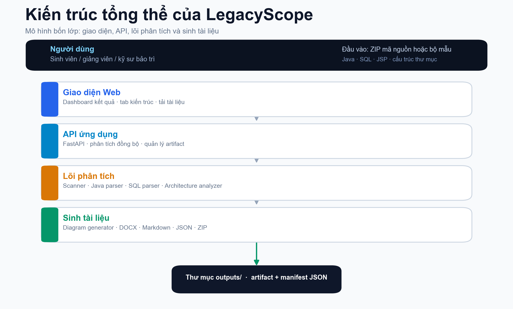
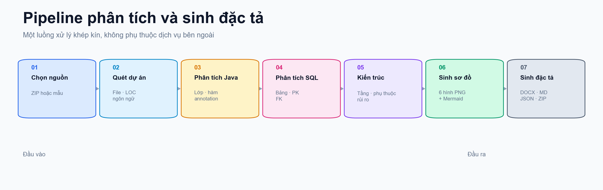
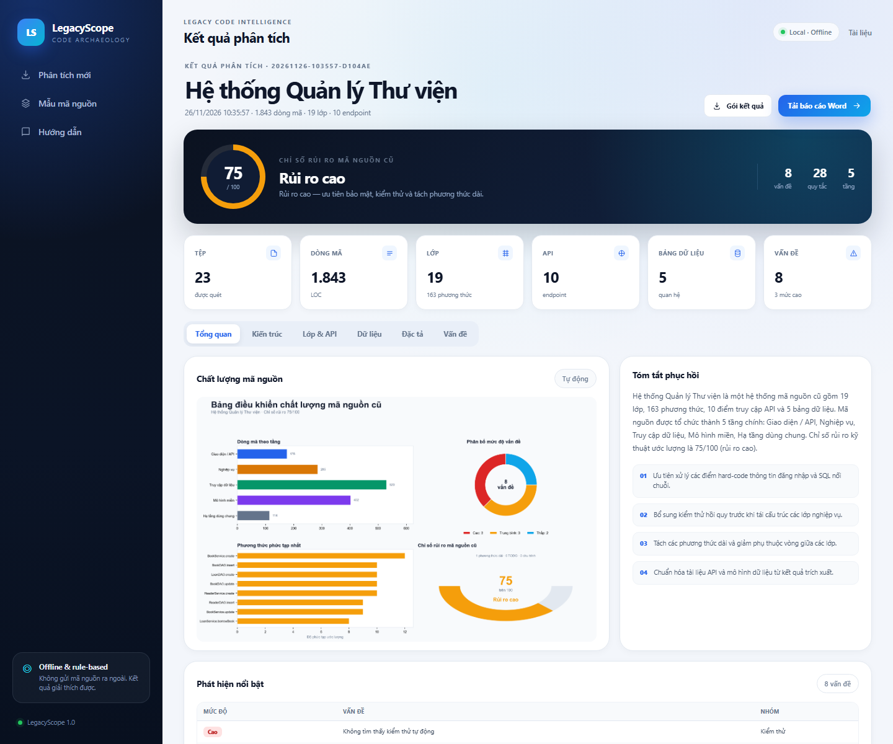

# LegacyScope

**Tự động hóa trích xuất đặc tả kỹ thuật và sơ đồ kiến trúc từ mã nguồn cũ.**

LegacyScope là công cụ phân tích tĩnh mã nguồn Java và SQL, giúp phục hồi cấu trúc lớp, API, mô hình dữ liệu, quan hệ phụ thuộc, quy tắc nghiệp vụ và các dấu hiệu nợ kỹ thuật của một hệ thống legacy. Kết quả được biến đổi thành dashboard trực quan, sáu sơ đồ kiến trúc và tài liệu kỹ thuật ở định dạng DOCX, Markdown, JSON.

Công cụ chạy hoàn toàn cục bộ, không gửi mã nguồn ra dịch vụ bên ngoài, không yêu cầu API key và không phụ thuộc cơ sở dữ liệu.

---

## 1. Bài toán

Các hệ thống phần mềm lâu năm thường vẫn vận hành ổn định nhưng đã mất dần tài liệu thiết kế, tài liệu API và kiến thức của đội ngũ phát triển ban đầu. Khi cần sửa lỗi, bổ sung chức năng, tái cấu trúc hoặc chuyển đổi công nghệ, kỹ sư phải đọc thủ công hàng nghìn dòng mã để trả lời các câu hỏi:

- Lớp nào đang xử lý nghiệp vụ?
- Dữ liệu đi qua những tầng nào?
- API nào gọi vào đâu?
- Bảng nào bị ảnh hưởng khi thay đổi?
- Rủi ro kỹ thuật và bảo mật nằm ở đâu?

LegacyScope giải quyết một phần bài toán đó bằng cách tự động quét mã nguồn, phục hồi các góc nhìn kiến trúc và sinh tài liệu kỹ thuật có thể đọc, kiểm chứng và bổ sung.

## 2. Tính năng chính

- **Phân tích mã nguồn Java**: package, lớp, giao diện, phương thức, thuộc tính, annotation, kế thừa, endpoint Servlet và Spring MVC.
- **Phân tích SQL**: bảng, cột, khóa chính, khóa ngoại và quan hệ giữa các bảng.
- **Phân tích kiến trúc**: phân tầng theo package/đường dẫn, đồ thị phụ thuộc, phát hiện chu trình, độ phức tạp và coupling.
- **Trích xuất quy tắc nghiệp vụ**: điều kiện kiểm tra, thông báo trả về, Javadoc và ràng buộc khóa ngoại.
- **Phát hiện nợ kỹ thuật**: SQL nối chuỗi, mật khẩu hard-code, JSP scriptlet, phương thức dài, TODO/FIXME, thiếu kiểm thử.
- **Sinh sáu sơ đồ**: kiến trúc phân tầng, phụ thuộc, sơ đồ lớp, ERD, luồng API và dashboard chất lượng.
- **Sinh tài liệu**: DOCX, Markdown, JSON và gói ZIP chứa toàn bộ artifact.
- **Dashboard web**: chọn mẫu hoặc upload ZIP, xem kết quả theo tab, tìm kiếm và tải tài liệu.

## 3. Kiến trúc

LegacyScope được tổ chức thành bốn lớp tách biệt: giao diện web, API ứng dụng, lõi phân tích và sinh tài liệu. Cách tách này cho phép chạy pipeline từ giao diện hoặc từ dòng lệnh mà không phải sửa logic phân tích.



## 4. Pipeline xử lý



1. Nhận ZIP hoặc chọn bộ mã nguồn mẫu.
2. Quét cấu trúc thư mục, nhận diện ngôn ngữ, đếm LOC/comment/TODO.
3. Phân tích Java để trích xuất lớp, phương thức, annotation, endpoint.
4. Phân tích SQL để trích xuất bảng, khóa chính, khóa ngoại.
5. Phân tích kiến trúc, phụ thuộc, chu trình và chỉ số rủi ro.
6. Sinh sơ đồ PNG và các tệp Mermaid.
7. Sinh DOCX, Markdown, JSON và đóng gói ZIP.

## 5. Công nghệ

| Thành phần | Công nghệ |
|---|---|
| Ngôn ngữ | Python 3.11+ |
| Backend | FastAPI, Uvicorn |
| Giao diện | HTML5, CSS3, JavaScript thuần |
| Sinh tài liệu | python-docx, python-pptx |
| Sinh sơ đồ | Matplotlib, NetworkX, Pillow |
| Phân tích | Java parser nhẹ, SQL parser, biểu thức chính quy |
| Lưu trữ | Thư mục `outputs/`, không cần cơ sở dữ liệu |

## 6. Cài đặt và chạy

```bash
git clone https://github.com/nthmaiii/legacyscope-legacy-code-analyzer.git
cd legacyscope-legacy-code-analyzer
python -m pip install -r requirements.txt
python app.py
```

Mở **http://127.0.0.1:8000**.

Trên Windows có thể chạy:

```bat
run_demo.bat
```

## 7. Sử dụng

### Chạy với bộ mẫu

1. Mở dashboard.
2. Chọn thẻ **Hệ thống Quản lý Thư viện**.
3. Bấm **Phân tích mẫu**.
4. Xem các tab Tổng quan, Kiến trúc, Lớp & API, Dữ liệu, Đặc tả, Vấn đề.
5. Tải báo cáo Word hoặc gói kết quả.

### Upload mã nguồn

Tạo file ZIP chứa mã nguồn Java và tệp `.sql`, sau đó kéo thả vào vùng upload. Giới hạn 30 MB. ZIP có thể chứa một thư mục gốc hoặc nhiều thư mục con.

Bộ mẫu có sẵn:

```text
sample_legacy/library_legacy/
```

## 8. Kết quả đầu ra

Mỗi lần phân tích tạo một thư mục trong `outputs/`:

```text
outputs/<analysis-id>/
├── Dac_ta_ky_thuat.docx
├── Dac_ta_ky_thuat.md
├── analysis.json
├── architecture_layers.png
├── dependency_graph.png
├── class_diagram.png
├── erd.png
├── api_flow.png
├── quality_dashboard.png
├── *.mmd
└── LegacyScope_<analysis-id>.zip
```

## 9. Kết quả trên bộ mẫu

| Chỉ số | Giá trị |
|---|---|
| Lớp | 19 |
| Phương thức | 163 |
| Endpoint | 10 |
| Bảng dữ liệu | 5 |
| Quan hệ phụ thuộc | 29 |
| Quy tắc nghiệp vụ ứng viên | 28 |
| Vấn đề phát hiện | 8 |
| Chỉ số rủi ro | 75/100 |
| Thời gian pipeline | khoảng 3 giây |



## 10. Cấu trúc thư mục

```text
.
├── app.py
├── requirements.txt
├── run_demo.bat
├── legacyscope/
│   ├── analysis.py
│   ├── scanner.py
│   ├── diagrams.py
│   ├── pipeline.py
│   ├── parsers/
│   │   ├── java_parser.py
│   │   └── sql_parser.py
│   ├── generators/
│   │   ├── docx_spec.py
│   │   ├── markdown_spec.py
│   │   └── json_export.py
│   └── web/
│       ├── index.html
│       ├── styles.css
│       └── app.js
├── sample_legacy/
│   └── library_legacy/
├── scripts/
│   ├── build_report.py
│   ├── build_slides.py
│   └── build_figures.py
├── docs/
│   └── assets/
└── outputs/
```

## 11. Hạn chế

- Phân tích tĩnh, không thực thi mã và không theo dõi luồng dữ liệu động.
- Hỗ trợ Java Servlet/Spring MVC cơ bản và SQL; chưa hỗ trợ PHP, C#, JavaScript hoặc ORM phức tạp.
- Quy tắc nghiệp vụ được trích xuất là **ứng viên**, cần chuyên viên xác nhận.
- Bộ phân tích Java dựa trên dấu ngoặc và biểu thức chính quy, có thể bỏ sót cú pháp hiếm hoặc mã sinh tự động.
- Tài liệu sinh theo mẫu, không thay thế đánh giá của chuyên gia.

## 12. Hướng phát triển

- Tích hợp JavaParser, Spoon hoặc Tree-sitter để tăng độ chính xác cú pháp.
- Bổ sung call graph, data flow và phát hiện design pattern.
- Hỗ trợ thêm PHP, C#, JavaScript/TypeScript.
- So sánh hai phiên bản mã nguồn để đánh giá tác động kiến trúc.
- Tích hợp tùy chọn LLM có kiểm chứng để sinh mô tả tự nhiên.
- Xuất trực tiếp sang Confluence, GitLab Wiki hoặc Jira.
- Đóng gói CI/CD và bổ sung kiểm thử tự động cho chính công cụ.
